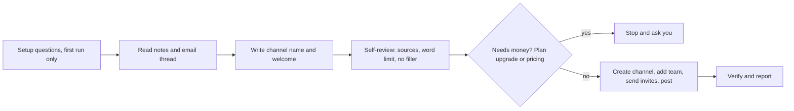

# slack-connect-onboarding

<p align="center">
  
</p>

<p align="center">
  <b>Shared Slack channels with customers, opened with a real welcome</b>
</p>

<p align="center">
  
  
  
  <a href="https://maritime.sh"></a>
</p>

<p align="center"><sub>WORKS WITH</sub><br>
  
  
  
  
  
  
</p>

A Claude Code skill that opens a shared Slack Connect channel with a customer, prospect or partner,
adds your team, invites their people by email, and posts a short welcome with real next steps.

The next steps come from your meeting notes, the email thread and what the customer asked for. No
generic filler. It asks its setup questions once, then does the whole job and reports what it did.

## How it works



1. **Asks once.** On the first run it asks for your company name for the channel pattern, your
   team, tone, where notes and email live, and a booking link. It saves them to `config.yaml`.
   Later runs ask nothing, unless you named only a company and no emails can be found.
2. **Gathers.** Finds the latest call notes and the email thread for that company, and pulls out
   what they asked for, what you promised, and any dates. Newest source wins. Checks whether a
   channel already exists.
3. **Writes.** Builds the channel name and a short welcome. Every date, owner and promise must come
   from a source.
4. **Checks itself.** A self-review gate: every fact traced to a source, word limits met, no
   filler, no secrets, links real, name valid. It fixes anything that fails before acting.
5. **Acts.** Creates the private channel, adds your team, sends Slack Connect invites one email at
   a time, then posts the welcome.
6. **Verifies and reports.** Confirms the post and the pending invites, then shows you the channel,
   people, the message as posted, and anything it left out for you to decide.

| What it does on its own | What it never does on its own |
| --- | --- |
| Creates the channel and adds your team | Puts pricing, discounts or credits in the welcome |
| Sends Slack Connect invites | Upgrades your Slack plan or clicks any billing button |
| Posts the welcome it wrote and checked | Invents a date, promise or feature |
| Verifies and reports | Gets past an admin-approval hold or a Slack warning |

## Safety

- **Money is the only approval.** Anything commercial is left out of the welcome and listed under
  "Left out for you to decide". If Slack Connect would need a plan upgrade, it stops and asks.
- **Hard stops.** It halts and reports on an admin-approval hold, a missing paid plan, any Slack
  warning, CAPTCHA, login or 2FA prompt, or any billing form.
- **Review mode.** Set `autonomy.mode: review` in `config.yaml` to see the exact channel, people
  and words before anything is created, invited or posted.
- **It acts in your name.** In the default mode, the invites and the message go out without a
  preview. Use review mode until you trust the output for your customers.

## Requirements

- A Slack workspace on a paid plan with Slack Connect enabled. Your admin may need to allow
  external invites.
- A way for Claude to use Slack:
  - a Slack MCP server for searching users and creating channels, and
  - a browser tool (for example Claude in Chrome) for sending Slack Connect invites and, by
    default, posting the message. Most Slack MCP servers cannot invite outside emails.
- Optional: a meeting notes tool (Granola, Fireflies, Otter, Zoom, or Google Docs) and Gmail
  access. Without them, paste the notes and the thread into chat.

## Install

```bash
git clone https://github.com/mariagorskikh/slack-connect-onboarding ~/.claude/skills/slack-connect-onboarding
```

## Configure

Claude asks for these on the first run and writes `config.yaml` for you. To set them by hand:

```bash
cd ~/.claude/skills/slack-connect-onboarding
cp config.example.yaml config.yaml
```

- `autonomy.mode`: `autonomous` (default) or `review`.
- `channel.name_pattern` and `channel.our_company`: for example `{our_company}-{customer}` gives
  `acme-northwind`.
- `team.members`: Slack handles or emails of people to add to every channel.
- `team.mention_in_welcome`: who to @mention as the people who can help.
- `welcome.tone_notes`, `welcome.booking_link`, word limits, and an optional facts file.
- `sources.meeting_notes`: `granola`, `fireflies`, `otter`, `zoom`, `google_docs` or `pasted`.
- `sources.email`: `gmail` or `pasted`.
- `posting.method`: `ui` (default) or `mcp`.

## Example

```
Add Dana (dana@northwind.com) and Priya (priya@northwind.com) from Northwind to Slack.
We had a call with them on Tuesday.
```

Claude does the work, then reports:

```
Channel:   #acme-northwind  (private, new)
Added from our team:  Sam Rivera, Lee Park
Invited (Slack Connect):  dana@northwind.com (pending), priya@northwind.com (pending)
Welcome message (as posted):
Hi Dana and Priya! Welcome! Great talking on Tuesday about moving your nightly route exports off
spreadsheets. Sam will send the API sandbox keys here by Thursday. Once you have them, send over
two or three sample export files and we will map the fields with you next week. Feel free to add
anyone on your data team. @Sam Rivera and @Lee Park are here for any questions. Our next call is
Monday at 10am PT.

Left out for you to decide:  their question about annual pricing
Skipped or stopped:  nothing
Sources used:  "Northwind intro" call (Tuesday), email "Re: route exports"
```

## Good to know

- Outside people must accept the Slack Connect invite, and their admin may need to approve it.
  They show as pending until then.
- Guests and Slack Connect are different. Guests join your workspace. Slack Connect keeps each
  company in its own workspace. The default is Slack Connect.
- It checks for an existing channel first, so you do not end up with two.

## Built by Maritime

<p align="center">
  <a href="https://maritime.sh">
    <picture>
      <source media="(prefers-color-scheme: dark)" srcset="assets/maritime-dark.png">
      
    </picture>
  </a>
</p>

This skill is open-sourced by [Maritime](https://maritime.sh) (YC F26), the cloud platform that gives every AI agent its own computer: sandboxes, agent boxes that keep their disk, and Linux desktops, Windows desktops and Android phones your agent can see and click. We run this skill ourselves.

## More open-source skills from Maritime

- [talking-head-reel](https://github.com/mariagorskikh/talking-head-reel): turn a messy phone recording into an edited vertical reel
- [outreach-conductor](https://github.com/mariagorskikh/outreach-conductor): a weekly outbound cycle, researched and written in your voice
- [product-changelog](https://github.com/mariagorskikh/product-changelog): changelog email, social posts and video from what you shipped
- [linkedin-inbox-triage](https://github.com/mariagorskikh/linkedin-inbox-triage): find the real people in your LinkedIn inbox and answer them
- [ad-ops](https://github.com/mariagorskikh/ad-ops): run Google, Meta, X and Reddit ad accounts with a change ledger

## License

MIT. See [LICENSE](LICENSE).
